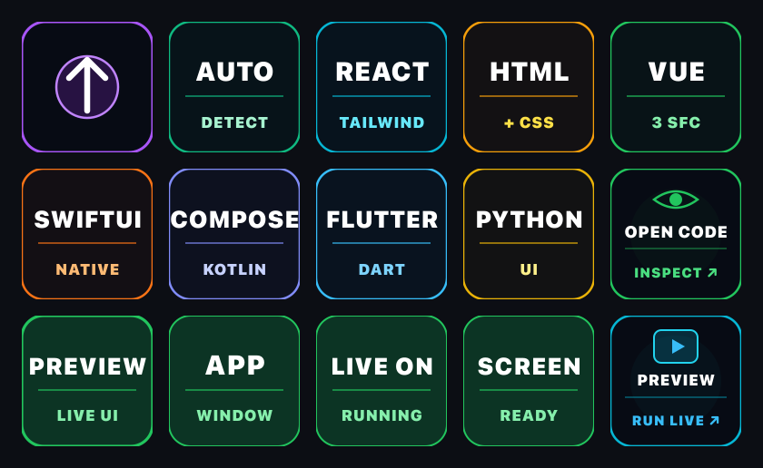
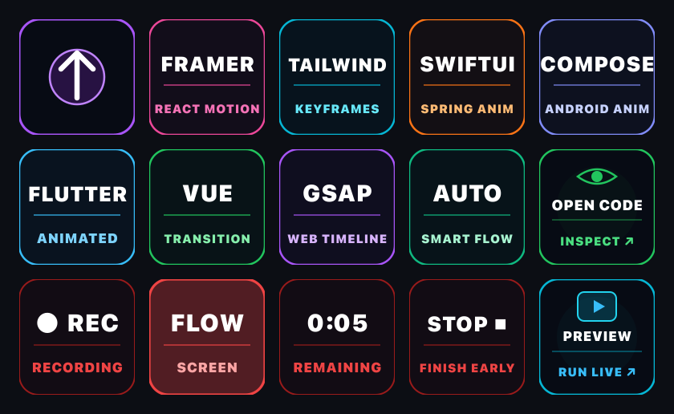
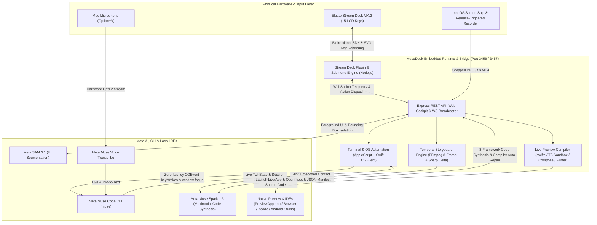
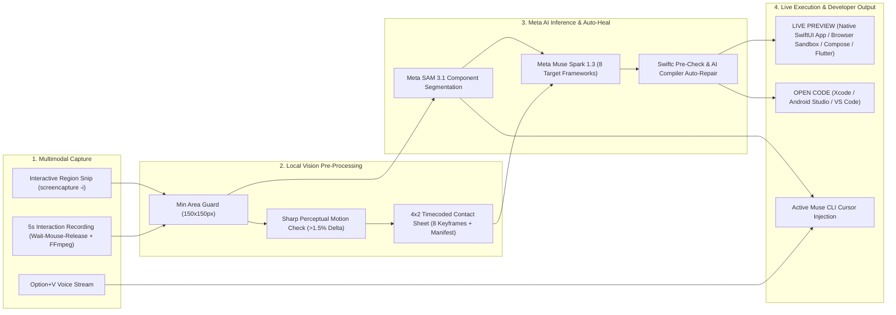
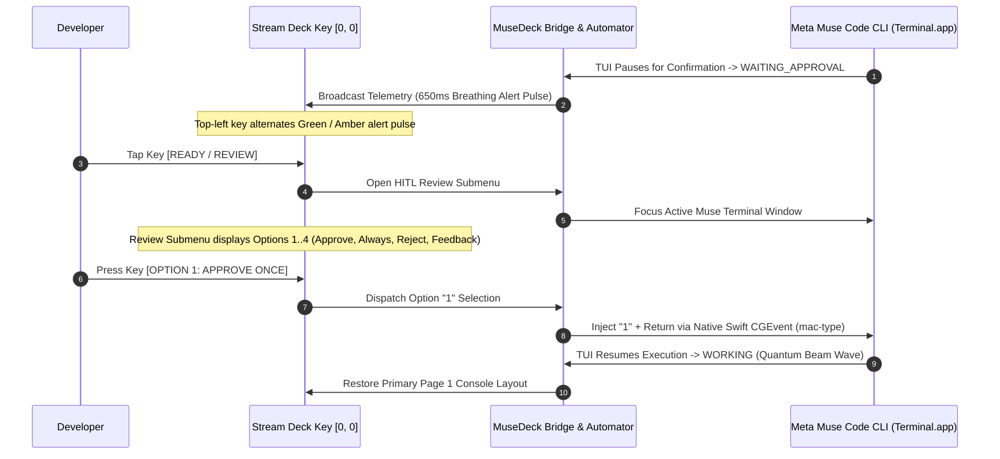

# MuseDeck

> **Tactile Mission Control for Meta Muse Code CLI & Meta AI**  
> Physical Elgato Stream Deck console bridging Muse Code CLI, Meta SAM 3.1, Muse Spark 1.3 & Voice Transcribe.

<p align="center">
  
  
</p>
<p align="center">
  <sub>Left: Physical Stream Deck MK.2 running MuseDeck. Right: 5×3 Quantum Beam wave (activates in <code>WORKING</code> state during code synthesis).</sub>
</p>

---

## Overview

Autonomous coding agents (such as Meta's **Muse Code CLI**) excel at end-to-end repository refactoring, test generation across parallel git worktrees, and terminal automation. However, developer trust and velocity break down when agent execution becomes an opaque black box:
* **Context Switching Friction**: Constant alt-tabbing between code editors, terminals, browsers, and documentation.
* **Review Anxiety**: Autonomous agents applying complex multi-file diffs without an unambiguous human verification gate.
* **Multimodal Bottlenecks**: Manually taking screenshots of Figma designs or recording buggy UI animations, saving files, and typing long prompts into terminal windows.

**MuseDeck** solves this by transforming the **Elgato Stream Deck MK.2** into a dedicated, physical mission control console:
1. **Physical Human-in-the-Loop (HITL) Review Gate**: When Muse Code pauses for confirmation, the top-left key pulses with a calm 650ms breathing alert. Tapping it surfaces the active terminal and opens a tactile Review Submenu (`APPROVE`, `ALWAYS`, `REJECT`, `FEEDBACK`).
2. **Multimodal Visual Engineering (Image-to-Code & Video-to-Code)**: One-touch screen snip powered by **Meta SAM 3.1** component segmentation and frontend synthesis via **Muse Spark 1.3**. Plus, 5-second desktop interaction recording with perceptual motion validation, 8-frame timecoded contact sheet assembly, and automated animated regression patching.
3. **Voice Transcribe Streaming**: Physical `VOICE` key toggles hardware `Option+V` microphone transcription directly at the active terminal prompt with zero typing.
4. **Session Switcher & History Drawer**: Physical session drawer monitoring active terminal tabs and scanning historical sessions across workspaces with high-contrast date badges (`TODAY`, `YESTRDY`, `OCT 29`).
5. **Living Developer Memory & Ops Cockpit**: One-touch access to architecture docs, living prompt qualifiers (`BE HONEST`, `DONT CODE`, `SHORT`, `SHOW OPTS`), a 13-key Git dashboard, and an emergency `HALT` switch.

---

## Primary Console (Page 1)


### Page 1 Key Layout

| Key Position | Button | Function & Developer Capability |
|:---:|:---:|---|
| **[0,&nbsp;0]** | **READY&nbsp;/&nbsp;REVIEW** | Dynamic agent status telemetry (`READY`, `PLAN`, `RUNNING`). When awaiting human approval (`WAITING_APPROVAL`), pulses with a calm 650ms breathing alert; tap opens the **Review Submenu**. |
| **[1,&nbsp;0]** | **VOICE** | Hardware `⌥+V` trigger for Meta Muse Voice Transcribe. Streams microphone audio directly into the active terminal cursor for zero-typing steering. |
| **[2,&nbsp;0]** | **SNIPPETS** | Rapid steering qualifier drawer (`BE HONEST`, `DON'T CODE`, `SHORT`, `SHOW OPTS`, `GO!`). |
| **[3,&nbsp;0]** | **STRUCT&nbsp;PROMPT** | In-place AI prompt refiner. Rewrites the current terminal input into a clear, well-structured English prompt for an AI coding assistant without auto-submitting. |
| **[4,&nbsp;0]** | **SESSIONS** | Active session counter. Tap opens the tactile **13-Key Session Switcher & Drawer**. |
| **[0,&nbsp;1]** | **SCREENSHOT** | Interactive macOS screen region snip. Dispatches to Meta SAM 3.1 to segment foreground UI components and injects coordinates at cursor. |
| **[1,&nbsp;1]** | **IMG&nbsp;TO&nbsp;CODE** | Opens the **8-Framework Image-to-Code Submenu** (`AUTO`, `REACT`, `HTML+CSS`, `VUE`, `SWIFTUI`, `COMPOSE`, `FLUTTER`, `PYTHON`) powered by Meta SAM 3.1 & Muse Spark 1.3 with one-touch `OPEN CODE` and `RUN LIVE PREVIEW`. |
| **[2,&nbsp;1]** | **VID&nbsp;TO&nbsp;CODE** | Opens the **8-Framework Video-to-Code Submenu** (`FRAMER`, `TAILWIND`, `SWIFTUI`, `COMPOSE`, `FLUTTER`, `VUE`, `GSAP`, `AUTO`). Records 5s UI flows, compiles an 8-frame timecoded contact sheet, and synthesizes animated components with live preview. |
| **[3,&nbsp;1]** | **MUSE&nbsp;SETTINGS** | Launches the local Web Mission Control configuration console in your browser (`http://localhost:3456`). |
| **[4,&nbsp;1]** | **CREDITS&nbsp;HUD** | Live Meta Model API credits tracker (`$148.01`). Tap opens the **10-Key Telemetry Dashboard**. |
| **[0,&nbsp;2]** | **VIDEO&nbsp;RECORD** | One-touch desktop video recording trigger for capturing reproducible bug flows and UI glitches. |
| **[1,&nbsp;2]** | **MUSE&nbsp;MEMORY** | Living architecture memory drawer (`MUSE RULES`, `SPEC.md`, `ARCH.md`, `DECISIONS.md`, `SYNC CONTEXT`). |
| **[2,&nbsp;2]** | **MUSE&nbsp;OPS** | Developer operations drawer (`FIX ERROR`, `REFACTOR`, `OPTIMIZE`, `EXPLAIN`, `RUN TESTS`). |
| **[3,&nbsp;2]** | **GIT&nbsp;COMMANDS** | 13-key tactile Git control deck (`STATUS`, `COMMIT`, `PULL`, `PUSH`, `DIFF`, `PR`). |
| **[4,&nbsp;2]** | **HALT** | Physical emergency stop switch. Instantly sends `SIGINT` / `SIGKILL` to abort runaway agent actions. |

---

## Submenu Consoles & Detailed Guides

### 1. Human-in-the-Loop (HITL) Review Submenu
When Muse Code generates file diffs and pauses for human verification, the top-left key pulses. Tapping it opens this dedicated confirmation modal:


* **[0, 0] ↑ BACK:** Return to the primary console without making a decision.
* **[1, 0] OPTION 1 (APPROVE ONCE):** Approves the tool/diff for this step (injects `1` + Enter into active terminal) and resumes autonomous execution.
* **[2, 0] OPTION 2 (ALWAYS ALLOW):** Grants blanket approval for this tool throughout the current session (`2`).
* **[3, 0] OPTION 3 (REJECT / DENY):** Denies the proposed changes (`3`) and instructs the agent to abort the action.
* **[4, 0] OPTION 4 (TELL WHY / FEEDBACK):** Pauses execution and prompts developer to provide explicit feedback in the terminal (`4`).

---

### 2. Image-to-Code (`IMG TO CODE` + SAM 3.1) Submenu
Tapping **`IMG TO CODE`** (`[1, 1]`) on the primary console opens a dedicated multi-framework visual synthesis cockpit powered by **Meta SAM 3.1** and **Muse Spark 1.3**:



#### Hardware Key Layout
* **[0, 0] ↑ BACK:** Returns to the primary console (automatically locked during active screen capture or cloud inference).
* **[1, 0] AUTO (DETECT):** Inspects the captured UI snip and automatically selects the optimal target stack.
* **[2, 0] REACT (TAILWIND):** Synthesizes a self-contained React + Tailwind CSS component (`GeneratedComponent.tsx`).
* **[3, 0] HTML (+ CSS):** Synthesizes clean, dependency-free HTML5 + CSS3 + JavaScript (`GeneratedComponent.html`).
* **[4, 0] VUE (3 SFC):** Synthesizes a Vue 3 Single-File Component (`GeneratedComponent.vue`) with `<script setup>` and scoped styles.
* **[0, 1] SWIFTUI (NATIVE):** Synthesizes a native macOS Apple SwiftUI view (`GeneratedComponent.swift`) with an `@main` executable harness.
* **[1, 1] COMPOSE (KOTLIN):** Synthesizes an Android Jetpack Compose screen (`GeneratedComponent.kt`) with `@Preview(showBackground = true)`.
* **[2, 1] FLUTTER (DART):** Synthesizes a complete Material 3 Flutter `StatelessWidget` / `StatefulWidget` (`GeneratedComponent.dart`).
* **[3, 1] PYTHON (UI):** Synthesizes an interactive Python desktop/web UI script (`GeneratedComponent.py`).
* **[4, 1] OPEN CODE (INSPECT ↗):** Appears automatically once synthesis finishes. Opens the generated source file in Xcode (for `.swift`), Android Studio (for `.kt`), or VS Code / Cursor.
* **[0..3, 2] 4-Key Live Status Banner:** Displays real-time hardware progress across four bottom keys (`WAIT FOR MUSE SPARK`, `COMPILING PREVIEW`, `PREVIEW APP LIVE ON SCREEN`, or `AREA TOO SMALL`).
* **[4, 2] PREVIEW (RUN LIVE ↗):** Appears automatically once synthesis finishes. Compiles, scaffolds, and launches an interactive live preview of the generated UI component.

#### End-to-End Execution Pipeline
1. **Interactive macOS Screen Snip:** Tapping any framework key inside `IMG TO CODE` activates the native macOS crosshair region selector (`screencapture -i`). Minimum capture area (`150×150 px`) is validated automatically.
2. **Meta SAM 3.1 Segmentation:** Dispatches the captured region to Meta's **Segment Anything Model 3.1** via the Meta Model API to isolate foreground UI elements and compute spatial bounding coordinates.
3. **Standalone & Terminal Dual-Dispatch:** Works standalone even if no terminal session is open; if an active Muse CLI terminal is present, coordinates and file references are also injected cleanly at the cursor.
4. **Muse Spark 1.3 Synthesis & Live Preview:** Feeds the segmented UI component to **Muse Spark 1.3**, writes the production-ready component to `/tmp/musedeck/generated/`, unlocks `OPEN CODE` (`[4, 1]`) and `PREVIEW` (`[4, 2]`), and launches the live interactive preview.

---

### 3. Video-to-Code (`VID TO CODE`) Submenu
Dynamic UI interactions (spring physics, keyframe transitions, multi-step flows, layout jitter) cannot be conveyed in a single static screenshot. Tapping **`VID TO CODE`** (`[2, 1]`) opens the temporal animation synthesis cockpit:



#### Hardware Key Layout
* **[0, 0] ↑ BACK:** Returns to the primary console.
* **[1, 0] FRAMER (REACT MOTION):** Synthesizes a React + Tailwind + Framer Motion interactive animation component (`AnimatedComponent.tsx`).
* **[2, 0] TAILWIND (KEYFRAMES):** Synthesizes a React + Tailwind CSS keyframe and transition component (`AnimatedComponent.tsx`).
* **[3, 0] SWIFTUI (SPRING ANIM):** Synthesizes a native macOS SwiftUI animated view (`AnimatedComponent.swift`) with `@State`, `TimelineView`, and `.spring()` transitions.
* **[4, 0] COMPOSE (ANDROID ANIM):** Synthesizes a Jetpack Compose animation screen (`AnimatedComponent.kt`) using `animate*AsState` and `AnimatedVisibility`.
* **[0, 1] FLUTTER (ANIMATED):** Synthesizes an animated Flutter widget (`AnimatedComponent.dart`) using `AnimationController` and `AnimatedContainer`.
* **[1, 1] VUE (TRANSITION):** Synthesizes a Vue 3 `<Transition>` / `<TransitionGroup>` Single-File Component (`AnimatedComponent.vue`).
* **[2, 1] GSAP (WEB TIMELINE):** Synthesizes an HTML5 + GSAP 3 timeline animation (`AnimatedComponent.html`).
* **[3, 1] AUTO (SMART FLOW):** Automatically selects the target animation stack based on the recorded interaction flow.
* **[4, 1] OPEN CODE (INSPECT ↗):** Appears once synthesis completes to open the generated animation source file in the appropriate IDE.
* **[0..3, 2] 4-Key Live Recording Countdown & Status HUD:** Displays `SELECT AREA TO RECORD` while aiming, counts down live (`0:05` to `0:01`) after mouse release with a physical **`STOP ■ (FINISH EARLY)`** key at `[3, 2]`, and animates synthesis/compilation status.
* **[4, 2] PREVIEW (RUN LIVE ↗):** Compiles and launches the synthesized animation in a native window or browser sandbox.

#### End-to-End Temporal Pipeline
1. **Interactive Region Selection & Release-Triggered Recording:** Tapping any target key lets you drag a screen region; the 5-second recording countdown starts only after you release the mouse button (tap `STOP ■` at `[3, 2]` to finish early).
2. **Perceptual Motion Detection:** Evaluates pixel delta across extracted frames using Sharp. If the recorded screen is static (`< 1.5%` delta), the 4-key banner alerts `STATIC SCREEN — USE IMG TO CODE` to prevent wasted API tokens.
3. **Temporal Filmstrip & Contact Sheet Assembly:** Extracts 8 sequential keyframes via FFmpeg, overlays individual timecode badges (`#1 0.00s` to `#8 5.00s`), and stitches them into a unified 4×2 contact sheet (`flow_montage.png`) alongside a structured `flow_manifest.json`.
4. **Multi-Frame Synthesis & Compiler Auto-Repair Loop:** Dispatches the 4×2 contact sheet and timeline manifest to **Meta Muse Spark 1.3**. For native SwiftUI targets, runs an automated `swiftc` pre-verification and compiler error auto-repair pass before unlocking `PREVIEW`.

#### Live Preview Toolchain Requirements (`IMG TO CODE` & `VID TO CODE`)
To use the **`PREVIEW (RUN LIVE ↗)`** key (`[4, 2]`) inside the `IMG TO CODE` and `VID TO CODE` submenus across all supported frameworks, install the corresponding SDKs/IDEs on macOS:

| Hardware Key | Target Framework | Live Preview Mechanism | Required Local Toolchain |
| :--- | :--- | :--- | :--- |
| **`REACT` / `TAILWIND` / `FRAMER`** | React + Tailwind CSS + Framer Motion (`.tsx`) | Pre-transpiled via TypeScript (`ts.transpileModule`) into an interactive browser sandbox (`preview.html`) | **None** (Runs in default macOS browser) |
| **`HTML` / `GSAP`** | HTML5 + CSS3 + GSAP 3 (`.html`) | Direct native browser rendering (`preview.html`) | **None** (Runs in default macOS browser) |
| **`VUE`** | Vue 3 SFC (`.vue`) | Compiled into a live Vue 3 browser mount (`preview.html`) | **None** (Runs in default macOS browser) |
| **`SWIFTUI`** | Apple SwiftUI (`.swift`) | Native macOS `.app` bundle compiled via `swiftc -parse-as-library` (`/tmp/musedeck/PreviewApp.app`) | **Xcode** & Command Line Tools (`xcode-select --install`) |
| **`COMPOSE`** | Android Jetpack Compose (`.kt`) | Scaffolds `/tmp/musedeck/ComposePreview` & opens `@Preview` LayoutLib canvas in Android Studio | **Android Studio** (`/Applications/Android Studio.app`) |
| **`FLUTTER`** | Flutter (`.dart`) | Scaffolds `/tmp/musedeck/FlutterPreview`, runs `flutter build web`, and serves at `http://localhost:3456/flutter` | **Flutter SDK** (`brew install --cask flutter` or `flutter` on `PATH`) |
| **`VID TO CODE`** | All 8 Animation Targets (Video Input) | 8-frame temporal contact sheet extraction (`flow_montage.png`) | **FFmpeg** (`brew install ffmpeg`) |

---

### 4. Sessions Drawer & Switcher Submenu
Effortlessly switch between concurrent terminal tabs and restore historical workspaces with zero terminal navigation commands:


* **[0, 0] ↑ BACK:** Return to the primary console.
* **[1, 0] + NEW SESSION:** Opens a native macOS folder selection dialog (`choose folder`) so you can choose which project directory to launch in a fresh Meta Muse terminal session.
* **Cards [2..14]:** Automatically scanned from active terminals and disk history. Displays high-legibility date badges (`TODAY`, `YESTRDY`, `OCT 29`), project names (`MUSEDECK`, `GLOBAL`, `GRID`), and timestamps. Tapping any card focuses its terminal window and restores full prompt context.

---

### 5. Prompt Snippets Submenu
Inject concise, battle-tested agent steering qualifiers into your terminal cursor with a single physical tap:


* **BE HONEST:** Injects: *"Be honest and critical. Point out what is wrong, suggest better approaches."*
* **DON'T CODE:** Injects: *"Do not execute yet. Outline the approach first, I will review before any implementation."*
* **SHOW OPTIONS:** Injects: *"Show me 2-3 alternatives with tradeoffs for each."*
* **EXPLAIN WHY:** Injects: *"Explain your reasoning and tradeoffs before acting."*
* **KEEP SHORT:** Injects: *"Keep it focused. Only what is needed, nothing extra."*
* **NO TESTS:** Injects: *"Skip tests for now. Focus on implementation only."*
* **GO!:** Submits the prompt line with an automated Enter keypress.

---

### 6. Muse Memory (Living Documentation) Submenu
Keeps autonomous agents strictly aligned with project architecture and institutional knowledge:


* **MUSE RULES:** Loads `rules.txt` project constraints into the active agent session.
* **SPEC.md & PLAN.md:** Opens and syncs technical design specifications and implementation plans.
* **TODO.md & PROGRESS.md:** Inspects remaining milestones and current development velocity.
* **ARCH.md & DECISIONS.md:** Re-anchors agent reasoning to established architecture principles and design decisions.
* **SYNC CONTEXT:** Scans all repository documentation in one pass to refresh agent context window.
* **UPDATE LOG:** Appends latest development milestones to project changelog.

---

### 7. Muse Ops (Developer Operations) Submenu
Triggers common daily refactoring and verification workflows directly from physical keys:


* **FIX ERROR:** Inspects clipboard stack traces or terminal error logs to diagnose root causes and synthesize fixes.
* **REFACTOR CODE:** Restructures selected code for readability, maintainability, and DRY/KISS compliance.
* **OPTIMIZE PERF:** Analyzes algorithmic bottlenecks and memory consumption to optimize execution speed.
* **EXPLAIN CODE:** Generates step-by-step walkthroughs of complex logic and subtle edge cases.
* **FIND SYMBOL:** Traces function, class, and symbol definitions across the entire workspace.
* **CODE REVIEW:** Runs comprehensive security, quality, and bug inspections across uncommitted diffs.
* **RUN TESTS / RUN BUILD / TYPE CHECK:** Triggers test suites, build bundlers, and TypeScript typecheckers with live reporting.

---

### 8. Git Commands Submenu
Complete tactile version control cockpit eliminating routine terminal git typing:


* **GIT STATUS & VIEW DIFF:** Displays unstaged files and visual line diff summaries.
* **GIT COMMIT:** Analyzes staged modifications to generate conventional semantic commit messages.
* **GIT PULL & PUSH:** Syncs local branch with remote repositories.
* **STASH SAVE & POP:** Safely shelves and restores in-flight work.
* **DISCARD (2-Tap Guard):** Double-tap confirmation protection to prevent accidental code loss when reverting changes.
* **CREATE PR:** Automatically drafts summary and opens a GitHub Pull Request in your default browser.

---

### 9. Credits & Telemetry Submenu
Real-time hardware HUD tracking Meta Model API resource utilization and cloud inference costs:


* **REMAINING CREDITS:** Live Meta Model API grant balance (`$148.01`).
* **TOTAL SPEND & REQUESTS:** Cumulative session expenditure (`$0.00`) and API call count (`21`).
* **INPUT & OUTPUT TOKENS:** Real-time token volume tracking (`433.9k in / 19.4k out`).
* **CACHE HIT RATE:** Model prompt caching efficiency (`57.7%`).
* **LATENCY:** Average round-trip API inference speed (`38 ms`).
* **BILLING CONSOLE ↗:** Quick shortcut to launch the official Meta Model API billing portal.

---

## System Architecture



---

## Multimodal Data Pipeline (`IMG TO CODE` & `VID TO CODE`)



---

## Human-in-the-Loop (HITL) Execution Sequence



---

## Muse Settings & Web Mission Control (`http://localhost:3456/settings`)

Tapping Key **[3, 1]** (`MUSE SETTINGS`) on your physical Stream Deck instantly opens the local **MuseDeck Mission Control Cockpit** in your default browser.


### Core Capabilities of the Settings Dashboard

1. **Meta Model API Credentials & Live Connectivity**:
   - Safely input and manage your **Meta Model API Key** with toggleable password visibility.
   - **Test Ping Button**: Executes an instant test ping to Meta's inference servers, measuring real-time latency (e.g. `38ms`) and confirming connectivity with Meta's **Muse Spark 1.3** and **SAM 3.1** models.

2. **Target Project Workspace Directory**:
   - Defines the active project folder where the Meta Muse terminal automatically launches when you trigger actions from physical keys (`Voice`, `Fix Bug`, `Image-to-Code`, `Test Runner`).
   - Includes a one-click **Current Path** reset button and native macOS directory browsing.

3. **Environment & System Health Diagnostic**:
   - **Meta Muse Code CLI (`muse`)**: Verifies path resolution (`~/.local/bin/muse`) and execution readiness.
   - **Terminal Automation (AppleScript / zsh)**: Validates Accessibility and System Events permissions for zero-latency keystroke injection into Terminal.app.
   - **Stream Deck Core Bridge**: Monitors bidirectional WebSocket (Port 3457) and HTTP REST API (Port 3456) link health.
   - **Meta Model API Connection**: Displays live uptime, latency, and active model status.

4. **Persistent Multi-Session Configuration**:
   - All settings are persistently saved to `~/.musedeck/config.json`, maintaining configuration across system reboots, different terminal projects, and Stream Deck restarts without repetitive setup.

5. **Interactive 5x3 Virtual Stream Deck**:
   - Mirrors the physical Stream Deck state in real time at `http://localhost:3456`, displaying live diffs, token consumption, and terminal execution logs for dual-screen setups.

---

## Quickstart

### Option A: One-Click Stream Deck Installer (Recommended)

MuseDeck ships as a **self-contained `.streamDeckPlugin` installer** with the Mission Control Bridge Server (`http://localhost:3456` & WebSocket `3457`), terminal session watcher, and 15-key hardware profile embedded directly inside the Stream Deck plugin runtime. No terminal background process or manual `npm start` is required.

1. **Download the Installer**:
   Download **`com.memetcircus.musedeck.streamDeckPlugin`** from the latest **[GitHub Release](https://github.com/memetcircus/musedeck/releases/latest)**.
2. **Double-Click to Install**:
   Double-click the downloaded `.streamDeckPlugin` file on macOS. The **Elgato Stream Deck** app will automatically install the plugin, prompt you to load the **MuseDeck** 15-key hardware profile, and launch the embedded bridge server in the background.
3. **Configure API Key & Workspace**:
   Press **`MUSE SETTINGS`** (`[3, 1]`) on your Stream Deck (or open **[http://localhost:3456/settings](http://localhost:3456/settings)** in your browser) to enter your **Meta Model API Key**, verify your **Model API Credits**, and select your active project workspace directory.
4. **Install Live Preview Toolchains (For `IMG TO CODE` & `VID TO CODE`)**:
   - **SwiftUI (`SWIFTUI` key)**: Install **Xcode** and run `xcode-select --install` so `swiftc` can compile and launch native SwiftUI desktop previews.
   - **Jetpack Compose (`COMPOSE` key)**: Install **Android Studio** (`/Applications/Android Studio.app`) to open and render `@Preview` Compose screens.
   - **Flutter (`FLUTTER` key)**: Install the **Flutter SDK** in your terminal (`brew install --cask flutter`) so MuseDeck can build and serve live Flutter previews.
   - **Video Storyboard (`VID TO CODE` key)**: Install **FFmpeg** (`brew install ffmpeg`) for 8-frame temporal contact sheet extraction.

---

### Option B: Build from Source (Developer Setup)

#### 1. Prerequisites
* macOS 13+ (Apple Silicon or Intel)
* Node.js 20+ (Node 24 recommended)
* Elgato Stream Deck app (v7.1+)
* Meta Muse Code CLI (`muse`) installed on PATH
* **Live Preview SDKs** (for `IMG TO CODE` / `VID TO CODE` previews): **Xcode** (`swiftc` for `SWIFTUI`), **Android Studio** (for `COMPOSE`), **Flutter CLI** (`flutter` for `FLUTTER`), and **FFmpeg** (`ffmpeg` for `VID TO CODE`).

#### 2. Installation & Packaging
```bash
# Clone the repository
git clone https://github.com/memetcircus/musedeck.git
cd musedeck

# Install dependencies
npm install

# Build server, bundle Stream Deck plugin, and generate .streamDeckPlugin installer in dist/
npm run pack
```

#### 3. Environment Configuration (Optional)
You can configure all settings via the Web UI (`http://localhost:3456/settings`) or copy `.env.example` to `.env`:
```bash
cp .env.example .env
```

```ini
PORT=3456
WS_PORT=3457
META_MODEL_API_KEY=your_meta_model_api_key_here
META_API_BASE_URL=https://api.meta.ai/v1
SAM_MODEL_NAME=sam-3.1
SPARK_MODEL_NAME=muse-spark-1.3
MUSE_CODE_BIN=muse
MUSE_CODE_SIMULATION=false
CLI_TIMEOUT_MS=180000
```

> **Simulation Mode**: If you do not have an active Meta Muse Code child process running, set `MUSE_CODE_SIMULATION=true` to test the state machine, 650ms breathing alert animations, and HITL review submenu gates immediately.

#### 4. Live Development & Symlink Installation
Either double-click `dist/com.memetcircus.musedeck.streamDeckPlugin` or symlink the plugin folder for live development:
```bash
ln -sfn "$(pwd)/com.memetcircus.musedeck.sdPlugin" ~/Library/Application\ Support/com.elgato.StreamDeck/Plugins/com.memetcircus.musedeck.sdPlugin
npx @elgato/cli restart com.memetcircus.musedeck
```
Open the Web Mission Control console at **[http://localhost:3456/settings](http://localhost:3456/settings)**.

---

## Testing

Run the automated test suites:
```bash
# Run all automated test suites
npm test

# Test Agent State Machine, Transitions & HITL Gates
npm run test:agent

# Test Meta Model API Client, SAM 3.1 & Muse Spark Synthesis
npm run test:meta

# Test Temporal Storyboard, Motion Detection & Contact Sheet Assembly
npm run test:storyboard
```

---

## License

Licensed under the [Apache-2.0 License](LICENSE).
