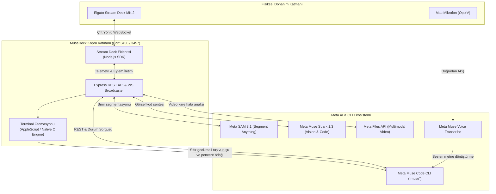
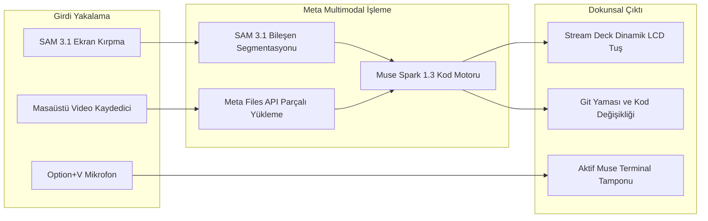
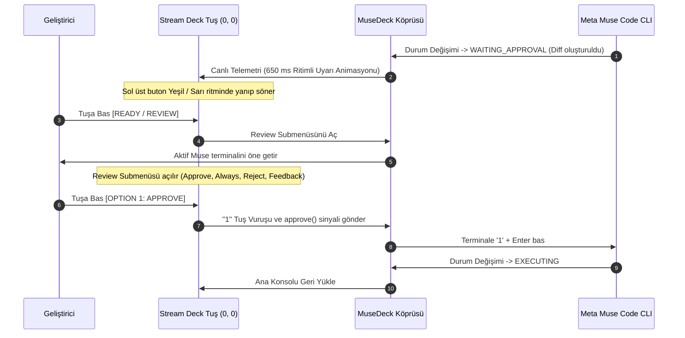

# MuseDeck ⚡

> **Tactile Mission Control, Multimodal Visual Synthesis & Real-Time Telemetry Console for Meta Muse Code CLI & Meta AI Models**  
> Direct physical integration between **Elgato Stream Deck MK.2** and Meta's developer intelligence stack: **Muse Code CLI**, **Meta Model API (SAM 3.1 & Muse Spark 1.3)**, and **Meta Voice Transcribe**.

---

## 🌟 Overview

Autonomous coding agents (such as Meta's **Muse Code CLI**) excel at end-to-end repository refactoring, test generation across worktrees, and terminal automation. However, developer trust and velocity break down when agent execution becomes an opaque black box:
* **Context Switching Friction**: Constant alt-tabbing between code editors, terminals, browsers, and docs.
* **Review Anxiety**: Autonomous agents applying complex multi-file diffs without an unambiguous human verification gate.
* **Multimodal Bottlenecks**: Manually taking screenshots of Figma designs or recording buggy UI animations, saving files, and typing long prompts into terminal windows.

**MuseDeck** solves this by turning the **Elgato Stream Deck MK.2** into a dedicated, physical mission control console:
1. **Physical Human-in-the-Loop (HITL) Review Gate**: When Muse Code pauses for confirmation, the top-left key pulses with a calm 650ms breathing alert. Tapping it surfaces the active terminal and opens a tactile Review Submenu (`APPROVE`, `ALWAYS`, `REJECT`, `FEEDBACK`).
2. **Multimodal Visual Engineering (Image-to-Code & Video-to-Code)**: One-touch screen snip powered by **Meta SAM 3.1** component segmentation and frontend synthesis via **Muse Spark 1.3**. Plus, desktop interaction recording for dynamic UI bugs uploaded via Meta Files API for automated regression patching.
3. **Voice Transcribe Streaming**: Physical `VOICE` key toggles hardware `Option+V` microphone transcription directly at the active terminal prompt with zero typing.
4. **Session Switcher & History Drawer**: Physical session drawer monitoring active terminal tabs and scanning historical sessions across workspaces with high-contrast date badges (`TODAY`, `YESTRDY`, `OCT 29`).
5. **Living Developer Memory & Ops Cockpit**: One-touch access to architecture docs, living prompt qualifiers (`BE HONEST`, `DONT CODE`, `SHORT`, `SHOW OPTS`), a 13-key Git dashboard, and an emergency `HALT` switch.

---

## 📸 Primary Console (Page 1)


### 🎛️ Page 1 Key Layout

| Tuş | Buton | İşlev ve Geliştirici Yeteneği |
|---|---|---|
| **[0, 0]** | **READY / REVIEW** | Canlı ajan durum göstergesi (`READY`, `PLAN`, `RUNNING`). Ajan onay beklediğinde (`WAITING_APPROVAL`) 650 ms ritimle yanıp söner; basıldığında **Review Submenüsü** açılır. |
| **[1, 0]** | **VOICE** | Meta Muse Voice Transcribe donanım tuşu. `⌥+V` mikrofon ses akışını doğrudan aktif terminaldeki imlece aktarır. |
| **[2, 0]** | **SNIPPETS** | Hızlı yönlendirme niteleyicileri çekmecesi (`BE HONEST`, `DON'T CODE`, `SHORT`, `SHOW OPTS`). |
| **[3, 0]** | **PROMPT (SPEC)** | Yapılandırılmış mühendislik şartnamesi formatlayıcı (Gereksinimler → Teknik Tasarım → Görev Listesi → Onay Kapısı). |
| **[4, 0]** | **SESSIONS** | Açık oturum sayısını gösteren çekmece butonu. Basıldığında **13 Tuşlu Oturum Değiştirici** açılır. |
| **[0, 1]** | **SCREENSHOT** | İnteraktif macOS ekran kırpma aracı. Meta SAM 3.1 ile UI bileşenlerini segmente eder ve koordinatları terminal imlecine iletir. |
| **[1, 1]** | **IMG TO CODE** | Meta Muse Spark 1.3 görsel kod sentezleyici. Kırpılan UI parçalarından React + Tailwind, Flutter veya Streamlit kodu üretir. |
| **[2, 1]** | **VID TO CODE** | Video-to-Code hata analizcisi. Masaüstü arayüz video kaydını Meta Files API'ye yükler, dinamik hataları tespit edip yama yazar. |
| **[3, 1]** | **MUSE SETTINGS** | Yerel web konsolunu (`http://localhost:3456`) tarayıcıda açar. |
| **[4, 1]** | **CREDITS HUD** | Kalan Meta Model API bakiyesini gösterir (`$149.97`). Basıldığında **10 Tuşlu Telemetri Paneli** açılır. |
| **[0, 2]** | **VIDEO RECORD** | Masaüstü hata akışlarını ve UI glitch'lerini tek tıkla kaydetme tuşu. |
| **[1, 2]** | **MUSE MEMORY** | Yaşayan hafıza çekmecesi (`MUSE RULES`, `SPEC.md`, `ARCH.md`, `DECISIONS.md`, `SYNC CONTEXT`). |
| **[2, 2]** | **MUSE OPS** | Geliştirici operasyonları (`FIX ERROR`, `REFACTOR`, `OPTIMIZE`, `EXPLAIN`, `RUN TESTS`). |
| **[3, 2]** | **GIT COMMANDS** | 13 tuşlu dokunsal Git kontrol paneli (`STATUS`, `COMMIT`, `PULL`, `PUSH`, `DIFF`, `PR`). |
| **[4, 2]** | **HALT** | Acil durdurma anahtarı. Kontrolden çıkan ajan işlemlerine anında `SIGINT` / `SIGKILL` gönderir. |

---

## 📂 Submenüler ve Detaylı Açıklamaları

### 1. Human-in-the-Loop (HITL) Review Submenüsü
Ajan dosyalarda değişiklik yapıp onay istediğinde sol üst buton yanıp söner ve tıklandığında bu onay ekranı açılır:


* **[0, 0] ↑ BACK:** Karar vermeden ana konsola geri döner.
* **[1, 0] OPTION 1 (APPROVE ONCE):** Değişikliği bu adım için onaylar (terminale `1` gönderir) ve ajanı çalıştırmaya devam eder.
* **[2, 0] OPTION 2 (ALWAYS ALLOW):** Mevcut oturum boyunca bu araç/komut için bir daha sormadan izin verir (`2`).
* **[3, 0] OPTION 3 (REJECT / DENY):** Değişikliği reddeder (`3`) ve ajanın adımı iptal etmesini sağlar.
* **[4, 0] OPTION 4 (TELL WHY / FEEDBACK):** İşlemi durdurur ve geliştiricinin terminalden neden reddettiğini gerekçelendirmesine olanak tanır (`4`).

---

### 2. Sessions Drawer (Oturum Değiştirici) Submenüsü
Birden fazla terminal penceresi veya geçmişte çalışılmış oturumlar arasında sıfır terminal komutuyla geçiş sağlar:


* **[0, 0] ↑ BACK:** Ana konsola dönüş.
* **[1, 0] + NEW SESSION:** Temiz, bağımsız yeni bir Meta Muse oturumu başlatır.
* **Kartlar [2..14]:** Disk geçmişinden ve aktif terminallerden taranan oturumlar. Üzerinde büyük tarih rozetleri (`TODAY`, `YESTRDY`, `OCT 29`), proje ismi (`MUSEDECK`, `GLOBAL`, `GRID`) ve oturum saati yer alır. Tıklandığında doğrudan o oturumun penceresi öne gelir ve bağlamı yüklenir.

---

### 3. Prompt Snippets Submenüsü
Terminalde uzun yönlendirme komutları yazmak yerine tek dokunuşla ajanın davranışını kısıtlayan niteleyiciler ekler:


* **BE HONEST:** *"Dürüst ve eleştirel ol. Hataları ve eksikleri açıkça söyle, daha iyi alternatifler öner."* promptunu iletir.
* **DON'T CODE:** *"Henüz kod yazma. Önce planı ve yaklaşımı açıkla, ben onayladıktan sonra uygula."* talimatını verir.
* **SHOW OPTIONS:** *"Her birinin artı ve eksileriyle birlikte 2-3 farklı alternatif yaklaşım göster."*
* **EXPLAIN WHY:** *"Harekete geçmeden önce gerekçeni ve tasarım ödünleşimlerini açıkla."*
* **KEEP SHORT:** *"Özet ve odaklı tut. Sadece gerekeni söyle, gereksiz laf kalabalığı yapma."*
* **NO TESTS:** *"Testleri şimdilik atla, doğrudan ana mantığı kodla."*
* **GO!:** İmleçteki komutu doğrudan Enter tuşuyla çalıştırır.

---

### 4. Muse Memory (Yaşayan Hafıza & Dokümantasyon) Submenüsü
Ajanın projeyi unutmaması ve bağlamı kaybetmemesi için projenin kök dizinindeki hafıza dosyalarını tek tıkla terminale besler:


* **MUSE RULES:** `rules.txt` kurallarını terminale yükler.
* **SPEC.md & PLAN.md:** Proje teknik tasarım ve uygulama planı dosyalarını açar/senkronize eder.
* **TODO.md & PROGRESS.md:** Kalan maddeleri ve mevcut ilerlemeyi kontrol ettirir.
* **ARCH.md & DECISIONS.md:** Mimari prensipleri ve alınan teknik kararları ajana hatırlatır.
* **SYNC CONTEXT:** Projedeki tüm hafıza dosyalarını tek seferde tarayıp ajan bağlamını yeniler.
* **UPDATE LOG:** Son yapılan değişiklikleri proje günlüğüne işletir.

---

### 5. Muse Ops (Geliştirici Operasyonları) Submenüsü
Günlük kodlama ve sorun giderme operasyonlarını tek tuşla tetikler:


* **FIX ERROR:** Panodaki veya terminaldeki son stack trace / hata çıktısını analiz ettirip otomatik yama üretir.
* **REFACTOR CODE:** Seçili kodu okunabilirlik ve DRY/KISS prensiplerine göre yeniden düzenletir.
* **OPTIMIZE PERF:** Algoritmik karmaşıklık ve bellek darboğazlarını analiz ettirip kodu optimize eder.
* **EXPLAIN CODE:** Kodun çalışma mantığını ve kritik sınır durumlarını adım adım açıklatır.
* **FIND SYMBOL:** Fonksiyon veya sınıfın proje genelindeki tanımlarını ve kullanımlarını taratır.
* **CODE REVIEW:** Son git değişikliklerine güvenlik ve kalite odaklı detaylı kod incelemesi yaptırır.
* **RUN TESTS / RUN BUILD / TYPE CHECK:** Proje testlerini, derleme komutlarını ve TypeScript tip denetimlerini çalıştırıp raporlar.

---

### 6. Git Commands Submenüsü
Terminalde git komutları yazmadan tüm versiyon kontrolünü fiziksel butonlarla yönetir:


* **GIT STATUS & VIEW DIFF:** Değişen dosyaları ve diff özetini görüntüler.
* **GIT COMMIT:** Yapılan değişiklikleri analiz ederek kurallara uygun semantik commit mesajı üretir ve commitler.
* **GIT PULL & PUSH:** Uzak depodan çekme ve gönderme işlemlerini yürütür.
* **STASH SAVE & POP:** Geçici değişiklikleri saklar veya geri yükler.
* **DISCARD (2-Tık Korumalı):** Kazara kod kaybını önlemek için çift tıklama onayıyla değişiklikleri temizler.
* **CREATE PR:** Otomatik PR açıklaması hazırlayıp GitHub üzerinde Pull Request açar.

---

### 7. Credits & Telemetry Submenüsü
Meta Model API kullanım metriklerini ve harcamalarını anlık olarak gösterir:


* **REMAINING CREDITS:** Kalan API bakiyesi (`$149.97`).
* **TOTAL SPEND & REQUESTS:** Toplam harcama (`$0.00`) ve çağrı sayısı (`21`).
* **INPUT & OUTPUT TOKENS:** Giriş ve çıkış token hacmi (`433.9k in / 19.4k out`).
* **CACHE HIT RATE:** Model prompt önbellek başarı oranı (`57.7%`).
* **LATENCY:** Ortalama API yanıt süresi (`38 ms`).
* **BILLING CONSOLE ↗:** Meta Model API faturalandırma ve kota yönetim sayfasını tarayıcıda açar.

---

## 🎨 Multimodal Engine: Image-to-Code & Video-to-Code

### 🖼️ Image-to-Code (`IMG TO CODE` + SAM 3.1)
1. **İnteraktif macOS Ekran Kırpma:** `SCREENSHOT` tuşuna basıldığında ekran seçim aracı açılır.
2. **Meta SAM 3.1 Segmentasyonu:** Görüntü Meta Model API üzerindeki **Segment Anything Model 3.1**'e gönderilir. Arka plan temizlenir, UI bileşenleri izole edilir ve koordinatlar hesaplanır.
3. **İmlece Doğrudan Enjeksiyon:** Terminaldeki mevcut metin silinmeden koordinatlar Meta Muse promptuna eklenir.
4. **Muse Spark 1.3 Sentezi:** `IMG TO CODE` tuşuna basıldığında kırpılan bileşen **Muse Spark 1.3** modeline beslenir ve saniyeler içinde React + Tailwind CSS, Flutter veya Streamlit kodu üretilir.

### 🎥 Video-to-Code (`VID TO CODE`)
Dinamik arayüz hataları (kırık animasyonlar, geçiş aksaklıkları, state senkronizasyon bozuklukları) statik ekran görüntüleriyle yakalanamaz:
1. **Tek Dokunuşla Kayıt:** `VIDEO RECORD` tuşuyla hata akışı ekranda yeniden canlandırılırken kayıt başlatılır.
2. **Meta Files API:** Kaydedilen video (`.mp4`) otomatik olarak Meta Files API'ye yüklenir.
3. **Çok Kareli Zamansal Analiz:** Meta multimodal hattı kareler arasındaki geçişleri ve CSS hatalarını tespit eder, ardından hatayı düzelten kod yamasını doğrudan projeye uygular.

---

## 🏛️ Mimari Şemalar

### Sistem Mimarisi



---

### Multimodal Veri Akışı



---

### Human-in-the-Loop (HITL) Onay Sıralaması



---

## 🖥️ Web Mission Control (`http://localhost:3456`)

Fiziksel donanıma ek olarak MuseDeck yerel bir web konsolu sunar:
* **İnteraktif 5x3 Sanal Deck:** Fiziksel Stream Deck'teki LCD durumunu tarayıcıda birebir yansıtır.
* **Canlı Diff ve Telemetri:** Yapılan kod değişikliklerini (`+X / -Y`), bellek ve token tüketimini izler.
* **Sistem Sağlığı:** Meta Muse Code CLI, AppleScript Terminal Otomasyonu, Stream Deck Köprüsü ve Meta Model API gecikmesini gerçek zamanlı doğrular.
* **Ayarlar Paneli:** API anahtarlarını, model seçimlerini (`muse-spark-1.3`, `sam-3.1`) ve çalışma klasörü yollarını yönetir (`~/.musedeck/config.json`).

---

## 🚀 Hızlı Başlangıç

### 1. Gereksinimler
* macOS 13+ (Apple Silicon veya Intel)
* Node.js 20+ (Node 24 önerilir)
* Elgato Stream Deck uygulaması (v7.1+)
* Meta Muse Code CLI (`muse`) PATH üzerinde kurulu olmalıdır

### 2. Kurulum
```bash
# Depoyu klonlayın
git clone https://github.com/memetcircus/musedeck.git
cd musedeck

# Bağımlılıkları yükleyin
npm install

# Sunucuyu ve Stream Deck eklenti paketini derleyin
npm run pack
```

### 3. Ortam Değişkenleri
`.env.example` dosyasını `.env` olarak kopyalayın ve Meta API bilgilerinizi girin:
```bash
cp .env.example .env
```

```ini
PORT=3456
WS_PORT=3457
META_MODEL_API_KEY=meta_model_api_anahtariniz
META_API_BASE_URL=https://api.meta.ai/v1
SAM_MODEL_NAME=sam-3.1
SPARK_MODEL_NAME=muse-spark-1.3
MUSE_CODE_BIN=muse
MUSE_CODE_SIMULATION=false
CLI_TIMEOUT_MS=180000
```

> **Simülasyon Modu:** Bilgisayarınızda aktif bir Meta Muse Code oturumu yoksa `MUSE_CODE_SIMULATION=true` yaparak durum makinesini, 650 ms animasyonları ve HITL onay submenüsünü anında deneyimleyebilirsiniz.

### 4. MuseDeck Köprüsünü Başlatma
```bash
npm run dev
# veya: npm start
```
Web Mission Control konsolunu tarayıcınızda açın: **[http://localhost:3456](http://localhost:3456)**.

### 5. Stream Deck Eklentisini Yükleme
Derlenen eklentiyi Elgato Stream Deck klasörüne bağlayın:
```bash
ln -sfn "$(pwd)/com.memetcircus.musedeck.sdPlugin" ~/Library/Application\ Support/com.elgato.StreamDeck/Plugins/com.memetcircus.musedeck.sdPlugin
```
Stream Deck uygulamasını yeniden başlattığınızda **MuseDeck** 15 tuşlu varsayılan profiliyle kullanıma hazır olacaktır.

---

## 🧪 Testler

Otomatik test paketlerini çalıştırın:
```bash
# Ajan Durum Makinesi, Geçişler ve HITL Onay Kapıları
npm run test:agent

# Meta Model API İstemcisi, SAM 3.1 ve Muse Spark Sentezi
npm run test:meta
```

---

## 🛡️ Lisans

Apache-2.0 Lisansı.
