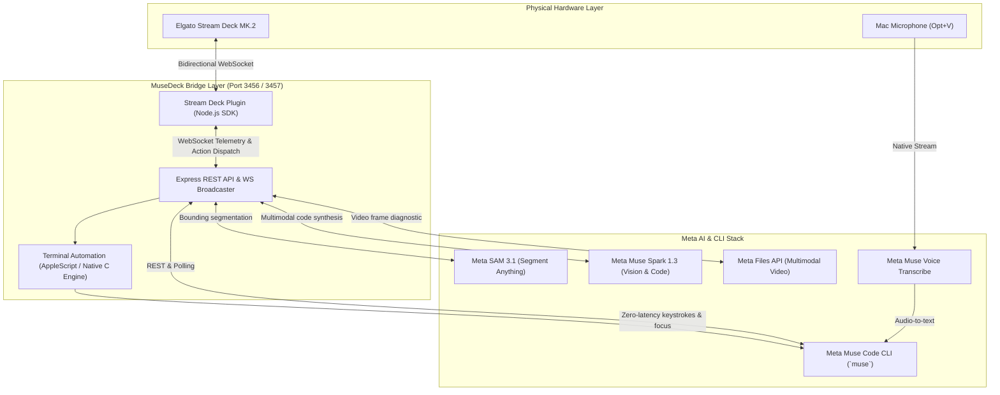
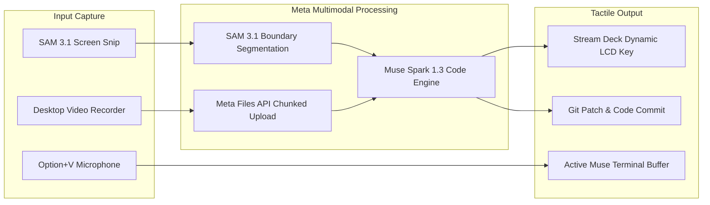
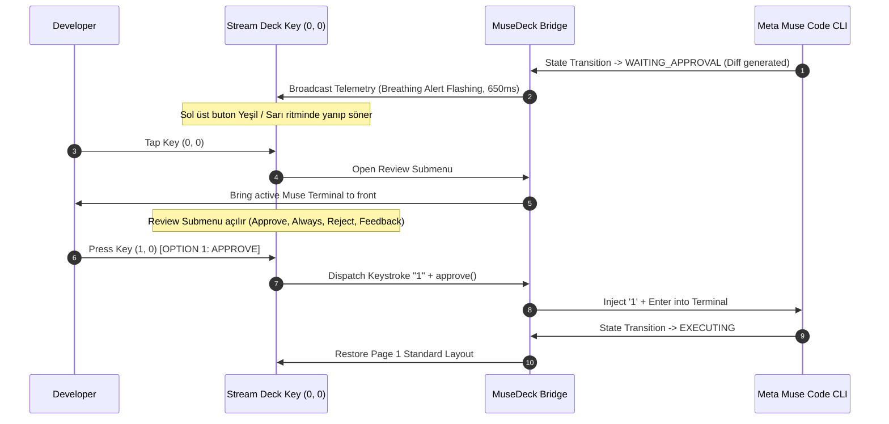

# MuseDeck ⚡

> **Tactile Mission Control, Multimodal Visual Synthesis & Real-Time Telemetry Console for Meta Muse Code CLI & Meta AI Models**  
> Direct physical integration between **Elgato Stream Deck MK.2** and Meta's developer intelligence stack: **Muse Code CLI**, **Meta Model API (SAM 3.1 & Muse Spark 1.3)**, and **Meta Voice Transcribe**.

---

## 🌟 Overview

Autonomous coding agents (such as Meta's **Muse Code CLI**) excel at end-to-end repository refactoring, test generation across worktrees, and terminal automation. However, developer trust and velocity break down when agent execution becomes an opaque black box:
* **Context Switching Friction**: Constant alt-tabbing between code editors, terminals, browsers, and docs.
* **Review Anxiety**: Autonomous agents applying complex multi-file diffs without an unambiguous human verification gate.
* **Multimodal Bottlenecks**: Manually taking screenshots of Figma designs or recording buggy UI animations, saving files, and typing long prompts into terminal windows.

**MuseDeck** solves this by turning the **Elgato Stream Deck MK.2** into a dedicated, physical mission control console:
1. **Physical Human-in-the-Loop (HITL) Review Gate**: When Muse Code pauses for confirmation, the top-left key pulses with a 650ms breathing alert. Tapping it surfaces the active terminal and opens a tactile Review Submenu (`APPROVE`, `ALWAYS`, `REJECT`, `FEEDBACK`).
2. **Multimodal Visual Engineering (Image-to-Code & Video-to-Code)**: One-touch screen snip powered by **Meta SAM 3.1** component segmentation and frontend synthesis via **Muse Spark 1.3**. Plus, desktop interaction recording for dynamic UI bugs uploaded via Meta Files API for automated regression patching.
3. **Voice Transcribe Streaming**: Physical `VOICE` key toggles hardware `Option+V` microphone transcription directly at the active terminal prompt with zero typing.
4. **Session Switcher & Resurrection Drawer**: Physical session drawer monitoring active terminal tabs and scanning historical sessions across workspaces, rendering high-contrast date badges (`TODAY`, `YESTRDY`, `OCT 29`).
5. **Living Developer Memory & Ops Cockpit**: One-touch access to architecture docs, living prompt qualifiers (`BE HONEST`, `DONT CODE`, `SHORT`, `SHOW OPTS`), a 13-key Git dashboard, and an emergency `HALT` switch.

---

## 📸 Stream Deck Hardware Consoles

### 1. Primary Mission Control (Page 1)


### 2. Physical Human-in-the-Loop (HITL) Review Submenu


### 3. Session Switcher & History Drawer


### 4. Real-Time Telemetry & AI Credits Dashboard


---

## 🎨 Multimodal Engine: Image-to-Code & Video-to-Code

MuseDeck treats multimodal inputs as first-class physical primitives:

### 🖼️ Image-to-Code (`IMG TO CODE` + SAM 3.1)
1. **Interactive macOS Region Snip**: Tapping the `SCREENSHOT` key activates interactive cursor selection.
2. **Meta SAM 3.1 Segmentation**: The image is dispatched to Meta's **Segment Anything Model 3.1** via Meta Model API to isolate foreground UI components and compute visual bounding boxes.
3. **Direct Terminal Coordinate Injection**: Screen coordinates are pasted directly at the active Muse Code cursor without overwriting existing prompt text.
4. **Muse Spark 1.3 Synthesis**: Tapping `IMG TO CODE` feeds the segmented visual component to **Muse Spark 1.3** to synthesize production-ready React + Tailwind CSS, Flutter, or Python Streamlit code.

### 🎥 Video-to-Code (`VID TO CODE`)
Dynamic UI glitches (broken animations, layout shifts, timing race conditions) are impossible to capture in a static screenshot:
1. **One-Touch Workflow Recording**: Tapping `VIDEO RECORD` starts a focused screen recording session while you reproduce the glitch.
2. **Meta Files API Dispatch**: The captured video (`.mp4`) is packaged and uploaded directly to the Meta Files API.
3. **Temporal Multi-Frame Analysis**: Meta's multimodal pipeline inspects frame transitions, pinpoints the faulty CSS keyframe or state transition, and writes the fix directly into the codebase.

---

## 🎛️ 15-Key Layout Mapping (Stream Deck MK.2)

| Key Coordinate | Primary Label | Action UUID | Description & Submenu Integration |
|---|---|---|---|
| **Col 0, Row 0** | **READY / REVIEW** | `com.memetcircus.musedeck.status` | Real-time agent status badge. Pulses 650ms breathing alert when `WAITING_APPROVAL`. Tap opens **Review Submenu**. |
| **Col 1, Row 0** | **VOICE** | `com.memetcircus.musedeck.task` | Hardware `⌥+V` trigger for Meta Muse Voice Transcribe audio streaming directly into active Terminal. |
| **Col 2, Row 0** | **SNIPPETS** | `com.memetcircus.musedeck.diff` | Quick prompt modifier drawer (`BE HONEST`, `DONT CODE`, `SHORT`, `SHOW OPTS`, `GO!`). |
| **Col 3, Row 0** | **PROMPT (SPEC)** | `com.memetcircus.musedeck.approve` | Structured spec transformer (Requirements → Tech Design → Task Breakdown → Review Gate). |
| **Col 4, Row 0** | **SESSIONS** | `com.memetcircus.musedeck.reject` | Session drawer key displaying open session count. Tap opens **13-Session Switcher**. |
| **Col 0, Row 1** | **SCREENSHOT** | `com.memetcircus.musedeck.sam-snip` | Interactive macOS screen region snip with SAM 3.1 component segmentation. |
| **Col 1, Row 1** | **IMG TO CODE** | `com.memetcircus.musedeck.spark-code` | Visual component synthesis via Meta Muse Spark 1.3 (React, Tailwind, Flutter, Streamlit). |
| **Col 2, Row 1** | **VID TO CODE** | `com.memetcircus.musedeck.run-muse` | Video-to-Code: Temporal desktop recording → Meta Files API → Automated bug diagnostic & patch. |
| **Col 3, Row 1** | **MUSE SETTINGS** | `com.memetcircus.musedeck.web-console` | Launches local Web Mission Control configuration console at `http://localhost:3456`. |
| **Col 4, Row 1** | **CREDITS HUD** | `com.memetcircus.musedeck.api-status` | Live Meta Model API credits tracker (`$149.97`). Tap opens **10-Key Telemetry Dashboard**. |
| **Col 0, Row 2** | **VIDEO RECORD** | `com.memetcircus.musedeck.prompt-task` | One-touch desktop video recording for bug reproduction and UI flow capture. |
| **Col 1, Row 2** | **MUSE MEMORY** | `com.memetcircus.musedeck.write-tests` | Living architecture memory drawer (Rules, Specs, Architecture, Decisions, Context Sync). |
| **Col 2, Row 2** | **MUSE OPS** | `com.memetcircus.musedeck.fix-bug` | Developer operations drawer (Terminal focus, test runner, git worktree tools). |
| **Col 3, Row 2** | **GIT COMMANDS** | `com.memetcircus.musedeck.commit-pr` | 13-Key tactile Git control deck (Status, Diff, Pull, Push, Branch, Stash, PR). |
| **Col 4, Row 2** | **HALT** | `com.memetcircus.musedeck.halt` | Physical emergency stop: Sends `SIGINT` / `SIGKILL` to abort runaway agent actions immediately. |

---

## 🏛️ System Architecture



---

## 🔄 Multimodal Data Pipeline



---

## ⚖️ Human-in-the-Loop (HITL) Execution Sequence



---

## 🖥️ Web Mission Control (`http://localhost:3456`)

In addition to physical hardware control, MuseDeck provides a local glassmorphism web console:
* **Interactive 5x3 Virtual Deck**: Mirrors the exact physical Stream Deck state with real-time key SVG rendering.
* **Live Diffs & Telemetry**: Visualizes git changes (`+X / -Y`), memory usage, and token consumption.
* **Environment System Health**: Real-time status for Meta Muse Code CLI, AppleScript Terminal Automation, Stream Deck Core Bridge, and Meta Model API latency.
* **Settings Cockpit**: Manage API keys, model parameters (`muse-spark-1.3`, `sam-3.1`), and persistent configs (`~/.musedeck/config.json`).

---

## 🚀 Quickstart

### 1. Prerequisites
* macOS 13+ (Apple Silicon or Intel)
* Node.js 20+ (Node 24 recommended)
* Elgato Stream Deck app (v7.1+)
* Meta Muse Code CLI (`muse`) installed on PATH

### 2. Installation
```bash
# Clone the repository
git clone https://github.com/memetcircus/musedeck.git
cd musedeck

# Install dependencies
npm install

# Build server and Stream Deck plugin bundle
npm run pack
```

### 3. Environment Configuration
Copy `.env.example` to `.env` and provide your Meta API credentials:
```bash
cp .env.example .env
```

```ini
PORT=3456
WS_PORT=3457
META_MODEL_API_KEY=your_meta_model_api_key_here
META_API_BASE_URL=https://api.meta.ai/v1
SAM_MODEL_NAME=sam-3.1
SPARK_MODEL_NAME=muse-spark-1.3
MUSE_CODE_BIN=muse
MUSE_CODE_SIMULATION=false
CLI_TIMEOUT_MS=180000
```

> **Simulation Mode**: If you do not have an active Meta Muse Code child process running, set `MUSE_CODE_SIMULATION=true` to test the state machine, breathing alert animations, and HITL review submenu gates immediately.

### 4. Running MuseDeck Bridge
Start the background mission control server:
```bash
npm run dev
# or: npm start
```
Open the Web Mission Control console at **[http://localhost:3456](http://localhost:3456)**.

### 5. Stream Deck Plugin Installation
Symlink the built plugin directly into your Elgato Stream Deck directory:
```bash
ln -sfn "$(pwd)/com.memetcircus.musedeck.sdPlugin" ~/Library/Application\ Support/com.elgato.StreamDeck/Plugins/com.memetcircus.musedeck.sdPlugin
```
Restart the Stream Deck app, and **MuseDeck** will automatically load with the default 15-key profile!

---

## 🧪 Testing

Run the automated test suites:
```bash
# Test Agent State Machine, Transitions & HITL Gates
npm run test:agent

# Test Meta Model API Client, SAM 3.1 & Muse Spark Synthesis
npm run test:meta
```

---

## 🛡️ License

Apache-2.0 License.
